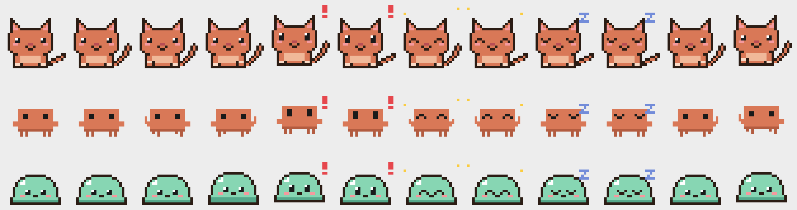

# ClaudeCat

A pixel-art pet that sits on top of the macOS Dock and shows what your Claude Code sessions are doing,
in the spirit of the Codex desktop pet.



| Pet | Meaning |
| --- | --- |
| tapping paws (cat), marching (Clawd), breathing (slime) | a session is working |
| strolling left and right | nothing needs you; it wanders near its spot every half minute or so |
| hopping, red `!`, orange card | a session waits for you (question, permission, plan approval) |
| happy eyes, sparkles, green card | a session just finished; the card shows its title and last reply |
| blinking | nothing running, recent activity |
| asleep, `z` | no activity for 20 minutes |

Each running, waiting or just-finished session gets a card above the pet, most urgent on top, at most
four. A running card shows what the session is doing right now ("Run the wallet unit tests",
"Правит Cards.swift") with a shimmer; a finished card shows the last reply until you dismiss it or
30 minutes pass.

Hover a card for its buttons:

| Card | Buttons |
| --- | --- |
| working | 💬 send a message (Claude gets it after the current step), ⏹ stop (at the next tool call) |
| finished | ↵ reply (wakes the session with your text) |
| waiting | ↗ open the session to answer there |
| any | × hide it until the session's next notification |

Hover the pet for the toolbar: ✎ new chat, voice input (macOS dictation) and a chevron that hides or
shows all cards, with a count of hidden ones. Messages and new chats are typed in a field that opens
below the pet when there is room, otherwise above it. A new chat opens in Claude Desktop with your text
filled in, in the folder of the latest session.

Click a card to open its session in Claude Desktop; click the pet to open the top card's session.
Sessions started with the `claude` CLI just bring Claude forward. Drag the pet anywhere; right-click it
for the session list, skin (cat, Clawd, slime), size, "hide all cards", "forget all sessions",
"back to the Dock" and quit.

The interface is in Russian; every string lives in `Sources/ClaudeCat/Strings.swift`.

## Install

Requires macOS 13+ and Xcode or the Swift toolchain.

```bash
./install.sh           # build, copy to ~/Applications, register hooks, launch
./install.sh --login   # same, and start at login
./uninstall.sh         # remove the app, LaunchAgent, hooks and state
```

`install.sh` backs up `~/.claude/settings.json` to `settings.json.bak-claude-cat` before adding the hooks,
and running it again replaces ClaudeCat's hooks instead of duplicating them. Claude Code picks up the
hooks in running sessions too.

## How it works

```
Claude Code ──hook JSON on stdin──▶ claude-cat-hook ──writes──▶ ~/.claude-cat/sessions/<id>.json
                                                                        │ directory events
                                                                        ▼
                                          ClaudeCat.app ◀── Board decides cards + pet mode
```

- **`claude-cat-hook`** runs for `SessionStart`, `UserPromptSubmit`, `PreToolUse`, `PostToolUse`,
  `PermissionRequest`, `Notification`, `Stop` and `SessionEnd`. It turns the event into a new session record
  and writes it atomically. It prints nothing and always exits 0, so it cannot change Claude's behavior,
  and it takes a few milliseconds because it links only Foundation.
- **Records hold facts, not words**: state, title (from the transcript's `custom-title`/`ai-title`
  entries, else the folder name), what the session is doing (`command`, `editing(file)`, …), why it
  waits, and the last reply as one plain line.
- **Talking back** goes through `~/.claude-cat/inbox/<id>.json`, which the session's own hooks read:
  a stop request makes the next `PreToolUse` answer `{"continue": false}`; a message is returned by the next
  `PostToolUse` as `additionalContext`; a reply to a finished session is picked up by
  `claude-cat-hook listen`, an `asyncRewake` Stop
  hook that waits in the background and wakes the session by exiting with code 2. The listener quits as
  soon as the session moves on; if none is running, the reply is copied to the clipboard and the session
  opens instead.
- **`ClaudeCat.app`** watches the directory, asks `Board` which sessions get cards and what the pet does
  (waiting > working > just finished > idle > asleep), and renders them.
- **Opening a session**: Claude Desktop keeps a `local_<uuid>.json` per Code session with the CLI id in
  `cliSessionId`, and opens one from `claude://code/continue?session=local_<uuid>`. This is not a
  documented interface; if it stops resolving, a click just brings Claude forward.

## Code

| Path | What |
| --- | --- |
| `Sources/ClaudeCatCore` | Foundation-only logic, fully unit-tested: session record and store, hook input and transitions, inbox, hook responses and the reply listener, transcript titles, `Board`, desktop session index, sprites |
| `Sources/claude-cat-hook` | the hook executable, a few lines over the core |
| `Sources/ClaudeCat` | the AppKit app: pet window and walker, cards, toolbar, composer, menu, strings, preferences |
| `Tests/ClaudeCatCoreTests` | XCTest suite for the core |

```bash
swift test                                                     # run the tests
swift run ClaudeCat --render-sheet docs/skins.png              # redraw the preview above
```

A new pet is one `PetSkin` struct in `Sprites.swift`, an entry in `Skins.all` and a name in `Strings.skin`.
